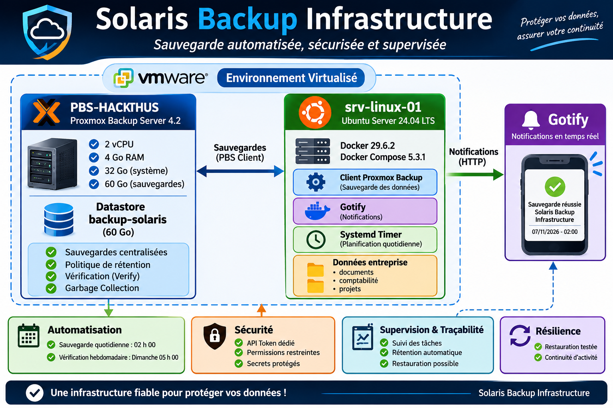

# Solaris Backup Infrastructure



**Infrastructure de sauvegarde automatisée avec Proxmox Backup Server, Ubuntu Server, Docker et Gotify**

- **Projet :** Solaris Backup Infrastructure
- **Version :** 1.0
- **Environnement :** Laboratoire virtualisé VMware Workstation
- **Système client :** Ubuntu Server 24.04 LTS
- **Solution de sauvegarde :** Proxmox Backup Server 4.2
- **Notifications :** Gotify
- **Statut :** Infrastructure opérationnelle : tests de sauvegarde et de restauration réussis.

## 1. Présentation du projet

Solaris Backup Infrastructure est un laboratoire informatique consacré à la conception, au déploiement et à l'administration d'une infrastructure de sauvegarde automatisée reposant exclusivement sur des solutions open source.

L'objectif est de mettre en place une solution permettant de :

- Sauvegarder automatiquement les données d'un serveur Linux.
- Centraliser les sauvegardes sur un serveur dédié.
- Restaurer les données en cas de perte ou de corruption.
- Définir une politique de rétention des sauvegardes.
- Vérifier l'intégrité des sauvegardes.
- Mettre en place un système de notifications.
- Automatiser les opérations récurrentes avec systemd.

Ce laboratoire reproduit certains besoins rencontrés dans les infrastructures informatiques d'entreprise.

## 2. Architecture technique

L'infrastructure repose sur deux machines virtuelles hébergées sur VMware Workstation.

### Serveur de sauvegarde ( PBS-SOLARIS )

- Proxmox Backup Server 4.2.
- 2 processeurs virtuels.
- 4 Go de mémoire RAM.
- Disque système de 32 Go.
- Disque dédié aux sauvegardes de 60 Go.
- Datastore : `backup-solaris`.
- Interface d'administration HTTPS sur le port 8007.

### Serveur client : srv-linux-01

- Ubuntu Server 24.04.4 LTS.
- Docker 29.6.2.
- Docker Compose 5.3.1.
- Client Proxmox Backup installé.
- Gotify déployé avec Docker Compose.
- Automatisation des sauvegardes avec systemd.

### Windows 11 client :

- Système utiliser pour l’administration du serveur de sauvegarde

### Schéma logique

```
                 ENVIRONNEMENT VMWARE
                         |
             +-----------+-----------+
             |                       |
             v                       v
    +------------------+    +----------------------+
    | PBS-SOLARIS      |    | srv-linux-01        |
    |                  |    | Ubuntu Server 24.04  |
    | Proxmox Backup   |    |                      |
    | Server 4.2       |<---| PBS Client           |
    |                  |    |                      |
    | Datastore        |    | Données entreprise  |
    | backup-solaris   |    |                      |
    +------------------+    | Systemd Timer        |
                            |                      |
                            | Gotify + Docker      |
                            +----------+-----------+
                                       |
                                       v
                                +-------------+
                                | Notifications|
                                | Gotify       |
                                +-------------+
```

## 3. Organisation des données sauvegardées

Sur le serveur Ubuntu, trois répertoires ont été créés pour simuler les données d'une entreprise.

```
/srv/entreprise/
├── documents/
├── comptabilite/
└── projets/
```

Ces répertoires représentent respectivement les documents administratifs, les données comptables et les fichiers liés aux projets de l'entreprise.

## 4. Configuration du stockage PBS

Un disque virtuel de 60 Go a été dédié au stockage des sauvegardes.

Les opérations réalisées :

1. Identification du disque supplémentaire.
2. Création d'une table de partition GPT.
3. Création d'une partition.
4. Formatage en ext4.
5. Montage sur `/mnt/datastore`.
6. Configuration du montage automatique avec `/etc/fstab`.
7. Création du datastore PBS `backup-solaris`.

Le montage persistant utilise l'identifiant UUID du système de fichiers.

## 5. Sécurisation des accès

Un compte dédié aux sauvegardes a été créé sur PBS :

- Utilisateur : `backup-client@pbs`
- API Token : `ubuntu01`
- Identité complète : `backup-client@pbs!ubuntu01`

Un accès limité aux opérations de sauvegarde a été configuré sur le datastore.

Le client Ubuntu utilise ce jeton pour communiquer avec PBS sans utiliser le compte administrateur.

Les informations sensibles sont conservées dans un fichier d'environnement protégé :

`/etc/proxmox-backup-client.env`

# Étape 2 - Préparer le disque de sauvegarde

Nous allons vérifier si le deuxième disque virtuel de 60 Go est bien détecté par Proxmox Backup Server.

## 1. Ouvrir le Shell

Dans l'interface Proxmox Backup Server :

1. Clique sur `Administration` dans le menu de gauche.
2. Clique sur `Coquille` (Shell).

Exécutions de la commande suivante :

```jsx
lsblk -o NAME,SIZE,TYPE,FSTYPE,MOUNTPOINTS
```

Cette commande permet de visualiser les disques présents dans le serveur.


- `sda` : disque système de Proxmox Backup Server.
- `sdb` : disque dédié aux sauvegardes, s'il est bien présent.

## Étape 2.1 - Formater le disque de sauvegarde

Note: cette opération efface les données du disque sélectionné.

Dans notre cas, nous ciblons exclusivement `/dev/sdb`, le disque virtuel de 60 Go .

Dans le Shell , exécutons les commandes suivantes:

### 1. Créer une partition ( fdisk)

```jsx
fdisk /dev/sdb
```

Tu vas entrer dans une interface interactive.

Saisis ces commandes une par une :

1. `g` → créer une table de partition GPT.
2. `n` → créer une nouvelle partition.
3. `Entrée` → numéro par défaut.
4. `Entrée` → premier secteur par défaut.
5. `Entrée` → dernier secteur par défaut.
6. `w` → enregistrer les modifications.


## 2. Vérifier la partition

En suite nous vérifions la partition avec la commande suivante :

```jsx
lsblk -o NAME,SIZE,TYPE,FSTYPE,MOUNTPOINTS
```


## 3. Formater `/dev/sdb1` en EXT4

Nous voulons obtenir une partition EXT4 de 60 Go destinée à accueillir les sauvegardes de notre infrastructure.

```jsx
mkfs.ext4 -L PBS_BACKUP /dev/sdb1
```


Affichons les périphériques de stockage en mode bloc connectés à au système.

```jsx
lsblk 
```


Le disque de sauvegarde est maintenant correctement partitionné.

- `/dev/sda` : disque système de 32 Go intact.
- `/dev/sdb` : disque de sauvegarde de 60 Go.
- `/dev/sdb1` : partition dédiée aux sauvegardes.

La commande `lsblk -f` permet d'afficher les périphériques de stockage Linux avec des informations supplémentaires sur leurs systèmes de fichiers

```jsx
lsblk -f
```


Nous allons maintenant le monter et le configurer pour qu'il soit automatiquement disponible après chaque redémarrage de Proxmox Backup Server.

## Étape 2.3 - Monter le disque

### 1. Créer le répertoire de stockage

```
mkdir -p /mnt/datastore
```

### 2. Monter la partition

```
mount /dev/sdb1 /mnt/datastore
```

### 3. Vérifier le montage

```
df -h /mnt/datastore
```


## Étape 2.4 - Rendre le montage permanent

Nous allons utiliser l'UUID de ta partition :

```
109cfd30-57b0-44d6-8b08-9535ed636fd7 
```

Dans le fichier de configuration :

```
nano /etc/fstab
```

Nous ajoutons cette ligne à la fin :

```
UUID=109cfd30-57b0-44d6-8b08-9535ed636fd7 /mnt/datastore ext4 defaults,nofail 0 2
```


Test de la configuration :

```
mount -a
```

Aucune erreur dans la sortie.

vérifions en suite avec la commande suivante :

```
findmnt /mnt/datastore
```

La commande `findmnt /mnt/datastore` permet de vérifier si le répertoire `/mnt/datastore` est un point de montage et d'afficher le système de fichiers qui y est associé

Contenu du fichier /etc/fstab


## Étape 2.5  Préparer les permissions

Avant de créer le datastore, vérifions que le répertoire est accessible à Proxmox Backup Server.

Exécutons la commande suivante :

```
ls -ld /mnt/datastore
```


# Étape 3  Créer le datastore backup-solaris

Nous allons maintenant déclarer notre disque dans Proxmox Backup Server.

Avant de créer le datastore, vérifions que le disque sera toujours monté après un redémarrage.

Exécute :

```
grep <UUID> /etc/fstab
```


## 3.1 Créer le datastore

Dans le Shell de PBS, exécute :

```jsx
proxmox-backup-manager datastore create backup-solaris /mnt/datastore
```


Cette commande va enregistrer notre espace de stockage dans Proxmox Backup Server et configurer les permissions nécessaires.

## 3.2 Vérifier sa création

Exécutons la commande suivante :

```
proxmox-backup-manager datastore list
```


La commande `proxmox-backup-manager datastore list` permet de lister les Datastores configurés sur un serveur Proxmox Backup Server

Puis vérifie également :

```
proxmox-backup-manager datastore show backup-solaris
```


La commande `proxmox-backup-manager datastore show backup-solaris` permet d'afficher les informations de configuration du Datastore nommé `backup-solaris` sur Proxmox Backup Server (PBS).

Elle sert notamment à vérifier le chemin de stockage associé au Datastore.

## 3.3 Vérifier dans l'interface Web


Datastore : `backup-solaris`

Emplacement : `/mnt/datastore`

# Étape 4 - Préparer le serveur Ubuntu client

Datastore backup-hackthus opérationnel

Nous allons maintenant connecter une machine Linux à notre serveur Proxmox Backup Server afin de réaliser notre première sauvegarde automatisée.

L'objectif est de simuler une entreprise qui possède plusieurs serveurs Linux et qui souhaite protéger ses données.

## 4.2 Vérifier la machine Ubuntu

Démarre ta VM Ubuntu et ouvre son terminal.

Exécutons ces trois commandes :

1. Identifier la version d'Ubuntu

```jsx
cat /etc/os-release
```


2. Identifier son adresse IP

```
ip -br addr
```


3. Vérifier la connectivité réseau

```
ping -c 4 1.1.1.1
```


## 4.3 Vérifier la communication avec PBS

Sur le serveur Proxmox Backup Server, récupère son adresse IP :

```jsx
ip a
```


Puis, depuis Ubuntu, teste la connexion :

```
ping -c 4 192.168.237.160
```


La communication est bien établir entre les deux systèmes

## 3. Installer le client Proxmox Backup

Ubuntu 24.04 peut utiliser le dépôt client Proxmox basé sur Debian Bookworm. Cette méthode a également été testée sur Ubuntu 24.04.

### A. Ajouter la clé officielle Proxmox

```
sudo wget https://enterprise.proxmox.com/debian/proxmox-release-bookworm.gpg \
-O /usr/share/keyrings/proxmox-release-bookworm.gpg
```


### B. Ajouter le dépôt

```
echo "deb [arch=amd64 signed-by=/usr/share/keyrings/proxmox-release-bookworm.gpg] http://download.proxmox.com/debian/pbs-client bookworm main" | sudo tee /etc/apt/sources.list.d/pbs-client.list
```


### C. Installer le client

```
sudo apt update
```

Puis :

```
sudo apt install -y proxmox-backup-client
```

### D. Vérifier l'installation

```
proxmox-backup-client version
```


## 4. Préparer les données à sauvegarder

Nous allons simuler les données d'une entreprise.

Crée cette arborescence :

```jsx
sudo mkdir -p /srv/entreprise/{documents,comptabilite,projets}
```

Crée quelques fichiers de test :

```
echo "Documents internes de SOLARIS" | sudo tee /srv/entreprise/documents/document1.txt

echo "Rapport comptable 2026" | sudo tee /srv/entreprise/comptabilite/rapport.txt

echo "Projet infrastructure informatique" | sudo tee /srv/entreprise/projets/projet1.txt
```

Vérification de la création de l’arborescence  et  des données :

```jsx
sudo tree /srv/entreprise
```


## 5. Préparer la connexion au serveur PBS

Nous allons ensuite créer un compte dédié à la sauvegarde sur PBS, avec un token API et les permissions minimales nécessaires.

Pour des raisons de sécurité c'est préférable à l'utilisation du compte `root@pam` pour les sauvegardes automatisées.

Notre objectif :


# Étape 5 - Configurer l'authentification sécurisée

Ubuntu 24.04 prêt

## 5.1 Créer un utilisateur dédié sur PBS


## 5.2 Créer un token API

Dans PBS :

1. Configuration → Access Control → API Tokens.
2. Cliquer sur Add.
3. Sélectionner l'utilisateur `backup-client@pbs`.
4. Nom du token : srv-linux-01.
5. Laisser l'expiration sur Never.
6. Valide avec Add.


## 5.3 Attribuer les permissions

Toujours dans PBS,  :

Configuration → Access Control → Permissions

Ajoutons deux permissions.

| Paramètre | Permission 1 | Permission 2 |
| --- | --- | --- |
| Path | `/datastore/backup-solaris` | `/datastore/backup-solaris` |
| User/Token | `backup-client@pbs` | `backup-client@pbs!ubuntu01` |
| Role | `DatastoreBackup` | `DatastoreBackup` |
| Propagate | Oui | Oui |


Pourquoi deux permissions ?

- L'utilisateur possède les droits de base.
- Le token possède ses propres droits.
- Les droits du token sont limités par ceux de son utilisateur.

Le rôle `DatastoreBackup` permet de créer et restaurer ses propres sauvegardes sans disposer des droits d'administration du datastore.

## 5.4 Récupérer l'empreinte du certificat PBS

Sur le Shell de Proxmox Backup Server, exécute :

```
proxmox-backup-manager cert info
```


Elle permettra à Ubuntu de vérifier l'identité du serveur PBS lors de la connexion.

## 5.5 Préparer les informations de connexion sur Ubuntu

Sur Ubuntu, nous utiliserons ces variables :

```jsx
 export PBS_REPOSITORY="backup-client@pbs!srv-linux-01@192.168.237.160:backup-solaris"
```


Pour le secret du token,  j’utilise une saisie masquée :

```jsx
read -rsp "Secret du token PBS : " PBS_PASSWORD
echo
export PBS_PASSWORD
```


Pour l'empreinte du certificat :

```
export PBS_FINGERPRINT="EMPREINTE_DU_CERTIFICAT"
```


Parfait ! Nous pouvons maintenant passer à la première sauvegarde réelle de notre machine Ubuntu vers Proxmox Backup Server (PBS).

Nous allons procéder progressivement : vérifier l'authentification, lancer une sauvegarde, puis contrôler qu'elle apparaît dans l'interface PBS.

### Étape 1 - Vérifier l'authentification depuis Ubuntu

Sur la VM Ubuntu, vérifions que les variables d'environnement sont toujours définies :

```
echo "$PBS_REPOSITORY"
echo "$PBS_FINGERPRINT"
```


Enfin, teste de la connexion :

```
proxmox-backup-client snapshot list
```


nous lancerons notre première sauvegarde :

```
proxmox-backup-client backup \
  documents.pxar:/srv/entreprise/documents \
  comptabilite.pxar:/srv/entreprise/comptabilite \
  projets.pxar:/srv/entreprise/projets
```

Cette commande va sauvegarder :

- `documents` : les documents internes.
- `comptabilite` : les rapports comptables.
- `projets` : les fichiers des projets.


Nous vérifierons ensuite les fichiers sauvegardés depuis l'interface PBS.

Dans le menu de gauche :

1. Clique droit sur Datastore.
2. Sélectionner `backup-solaris`.
3. Ouvrir l'onglet Content.

Tu pourras y consulter les sauvegardes enregistrées.


### 4. Vérifier les tâches

Dans l'interface PBS, consulte également Administration → Tasks


Excellent !  Notre première sauvegarde de l'infrastructure Solaris Backup est opérationnelle.

Nous allons maintenant vérifier que les données peuvent être restaurées. C'est une étape essentielle pour démontrer la fiabilité de notre solution.

## Étape 3 - Préparer le test de restauration

Sur Ubuntu, exécutons la commande suivante :

```
proxmox-backup-client snapshot list
```

Cette commande permet d'afficher les snapshots disponibles dans ton datastore.


Nous allons maintenant effectuer un test de restauration pour confirmer que notre sauvegarde est exploitable.

## Étape 4 - Restaurer les fichiers

Sur Ubuntu, créons un répertoire de restauration temporaire :

```
sudo mkdir -p /tmp/restore-solaris
```

Puis exécutons :

```
sudo -E proxmox-backup-client restore \
  "host/srv-linux-01/2026-11-07T22:44:43Z" \
  documents.pxar \
  /tmp/restore-solaris/documents
```

L'option `-E` permet de conserver les variables d'environnement PBS déjà configurées dans ta session, notamment l'authentification.


### Étape 4.2 - Vérifier la restauration

la commande se termine sans erreur :

```
sudo ls -lR /tmp/restore-solaris/documents
```


Puis comparaison du fichier restauré avec l'original :

```
cat /srv/entreprise/documents/document1.txt
```

```
sudo cat /tmp/restore-solaris/documents/document1.txt
```


Les deux contenus sont identiques.

Nous avons maintenant validé deux fonctions essentielles de notre infrastructure :

1. Sauvegarde : Ubuntu envoie correctement ses données vers Proxmox Backup Server.
2. Restauration : les fichiers sauvegardés peuvent être récupérés et leur contenu est identique à l'original.

## Étape 5 - Automatiser les sauvegardes quotidiennes

Nous passons maintenant à la configuration d’ une sauvegarde automatique chaque jour à 02h00 avec `systemd`.

Elle permettra de sauvegarder les trois répertoires :

- Documents
- Comptabilité
- Projets

Nous allons également prévoir des journaux d'exécution pour suivre les sauvegardes et détecter les erreurs.

L'objectif est que la sauvegarde fonctionne même si nous ne somme pas connecté à la session Ubuntu serveur.

## Étape 5.1 - Créer le fichier de configuration sécurisé

Sur srv-linux-01, créons un fichier réservé à root :

```
sudo vim /etc/proxmox-backup-client.env 
```

Ajoutons les trois variables suivantes en remplaçant les valeurs par celles de ta configuration :

```jsx
PBS_REPOSITORY="backup-client@pbs!srv-linux-01@192.168.237.160:backup-solaris"
PBS_PASSWORD="SECRET_DU_TOKEN"
PBS_FINGERPRINT="3b:0d:08:e4:58:e4:2e:87:38:5c:4d:26:d4:f5:e9:2b:7b:8b:c6:f0:64:ce:35:27:5a:23:fb:e3:9c:16:2c:ae"
```


Protègeons ensuite ce fichier :

```
sudo chmod 600 /etc/proxmox-backup-client.env
sudo chown root:root /etc/proxmox-backup-client.env
```


## Étape 5.2 - Créer le script de sauvegarde

Création du script backup-solaris.sh :

```
sudo vim /usr/local/sbin/backup-solaris.sh
```

code complet du script :

```jsx
#!/bin/bash

set -euo pipefail

# Dépôt PBS
export PBS_REPOSITORY

# Secret du token API
export PBS_PASSWORD

# Empreinte du certificat PBS
export PBS_FINGERPRINT

# Sauvegarde des données
proxmox-backup-client backup \
    documents.pxar:/srv/entreprise/documents \
    comptabilite.pxar:/srv/entreprise/comptabilite \
    projets.pxar:/srv/entreprise/projets

echo "Sauvegarde Solaris terminée avec succès."

```


Rendons le script exécutable :

```
sudo chmod 750 /usr/local/sbin/backup-solaris.sh
```


## Étape 5.3 - Créer le service systemd

```
sudo vim /etc/systemd/system/backup-solaris.service
```

code complet du service : 

```jsx
[Unit]
Description=Solaris Backup - Sauvegarde vers Proxmox Backup Server
Wants=network-online.target
After=network-online.target

[Service]
Type=oneshot
User=root
EnvironmentFile=/etc/proxmox-backup-client.env
ExecStart=/usr/local/sbin/backup-solaris.sh
```


## Étape 5.4 - Créer le timer quotidien

```
sudo vim /etc/systemd/system/backup-solaris.timer
```

Ajoutons le code suivant :

```jsx
[Unit]
Description=Solaris Backup - Sauvegarde quotidienne à 02h00

[Timer]
OnCalendar=*-*-* 02:00:00
Persistent=true
Unit=backup-solaris.service

[Install]
WantedBy=timers.target
```


`Persistent=true` permet de déclencher une sauvegarde manquée lorsque la machine était éteinte, après son redémarrage.

## Étape 5.5 - Activer le timer

Exécutons :

```
sudo systemctl daemon-reload
sudo systemctl enable --now backup-solaris.timer
```

Vérification :

```
systemctl list-timers backup-solaris.timer
```


## Étape 5.6 - Tester immédiatement

Pour ne pas attendre 02h00 nous testons immédiatement  :

```
sudo systemctl start backup-solaris.service
```

Vérification du résultat :

```
sudo systemctl status backup-solaris.service
```


Puis consultons les journaux :

```
sudo journalctl -u backup-solaris.service -n 30 --no-pager
```


Nous avons maintenant une infrastructure de sauvegarde fonctionnelle avec :

- Un datastore dédié sur PBS : `backup-solaris`.
- Une sauvegarde de fichiers du serveur srv-linux-01.
- Un test de restauration réussi.
- Un service systemd pour exécuter les sauvegardes.
- Un timer quotidien à 02h00.
- Des journaux pour contrôler les exécutions.

La prochaine étape est de gérer la durée de conservation des sauvegardes afin d'éviter de remplir notre disque de 60 Go.

## Étape 6 - Configurer la rétention sur PBS

Pour notre lab de 60 Go, je te propose une politique de rétention simple :

| Paramètre | Valeur | Signification |
| --- | --- | --- |
| Keep Last | 3 | Conserver les 3 dernières sauvegardes |
| Keep Daily | 7 | Conserver une sauvegarde par jour sur 7 jours |
| Keep Weekly | 4 | Conserver une sauvegarde par semaine sur 4 semaines |
| Keep Monthly | 3 | Conserver une sauvegarde par mois sur 3 mois |

Ces règles permettent de garder des points de restauration récents et historiques. Le pruning retire les snapshots qui ne sont plus retenus ; le Garbage Collection récupère ensuite l'espace des blocs devenus inutilisés.

- Connecter à PBS.
- Clique sur `Datastore`.
- Sélectionne `backup-solaris`.
- Ouvre l'onglet `Prune & GC`.
- Clique sur `Edit`.
- Configure les paramètres de rétention ci-dessus.
- Configure le Garbage Collection Schedule, par exemple `sun 04:00`.
- Configure le Prune Schedule, par exemple `sun 03:00`.
- Enregistre.


Pourquoi ces valeurs ?

- 3 dernières sauvegardes : conserver les points de restauration récents.
- 7 sauvegardes quotidiennes : conserver une semaine d'historique.
- 4 sauvegardes hebdomadaires : conserver environ un mois.
- 3 sauvegardes mensuelles : conserver un historique plus long.

Clique sur `Add` ou `OK` pour enregistrer le job.

3. Ordre d'exécution


Important : Prune et Garbage Collection sont deux opérations différentes. Prune retire les snapshots non retenus par la politique ; GC récupère les blocs qui ne sont plus référencés.

Nous avons maintenant configuré la politique de rétention et le nettoyage automatique de notre infrastructure Solaris Backup.

Notre infrastructure Solaris Backup dispose désormais :

- D'un datastore dédié.
- D'une sauvegarde du serveur srv-linux-01 fonctionnelle.
- D'un test de restauration validé.
- D'une automatisation quotidienne à 02h00.
- D'une politique de rétention.
- D'un Garbage Collection planifié.

## Étape 7 - Configurer les Verify Jobs

Nous allons programmer une vérification hebdomadaire de l'intégrité des sauvegardes.

La vérification permet à PBS de contrôler que les données sauvegardées sont toujours lisibles et que leur intégrité est correcte.

| Paramètre | Valeur |
| --- | --- |
| Datastore | `backup-solaris` |
| Schedule | `sun 05:00` |
| Ignore Verified | Décoché |
| Namespace | Défaut (`root`) |
| Comment | `Verification Solaris Backup` |

Dans PBS :

1. Sélectionnons `Datastore → backup-solaris`.
2. Clique droit sur `Verify Jobs`.
3. Cliquons sur `Add`pour enregistrer le job.


Pourquoi dimanche à 05h00 ?

Nous avons déjà :

- Dimanche à 03h00 : Prune.
- Dimanche à 04h00 : Garbage Collection.
- Dimanche à 05h00 : Verify.

Cela permet de répartir les opérations dans le temps.

Ignore Verified doit rester décoché pour demander une vérification complète des snapshots concernés, y compris ceux déjà vérifiés.

## Étape 7.2 - Enregistrer et tester

Sélectionnons le job et cliquons sur `Run now` pour lancer une première vérification.


status ok


Notre infrastructure Solaris Backup dispose maintenant d'une chaîne de sauvegarde complète :

1. Sauvegarde automatique quotidienne.
2. Rétention des snapshots.
3. Garbage Collection.
4. Vérification hebdomadaire de l'intégrité.
5. Restauration testée avec succès.

## Étape 8.1 - Configurer la destination des notifications

 l'objectif est de recevoir une notification lorsqu'une sauvegarde ou une vérification échoue, plutôt que de devoir consulter PBS manuellement.

PBS prend notamment en charge les notifications par SMTP, Sendmail et Gotify

architecture recommandée pour le lab


Dans l'interface PBS, ouvrons :

`Configuration → Notifications → Notification Targets`

Je choisir Gotify, car nous pourrons apprendre à déployer un service Docker, configurer une API et superviser les événements de notre infrastructure sans dépendre d'un service externe.

Nous allons déployer Gotify directement sur notre VM Ubuntu 24.04, qui sert déjà de client de sauvegarde PBS.

## Étape 8.1 - Vérifier Docker sur Ubuntu

Sur la VM Ubuntu, exécutons :

```jsx
docker --version
docker compose version
```


Puis vérifions que Docker fonctionne :

```
sudo systemctl status docker
```


## Étape 8.2 - Créer le dossier Gotify

Sur Ubuntu, exécutons :

```
sudo mkdir -p /opt/gotify
sudo chown -R "$USER":"$USER" /opt/gotify
cd /opt/gotify
```


## Étape 8.3 - Créer le fichier Docker Compose

nous allons créer le fichier docker-compose.yml pour la configuration de l’image docker du projet

```
vim docker-compose.yml
```

Code complet de docker-compose.yml

```jsx
services:
  gotify:
    image: gotify/server:latest
    container_name: gotify
    restart: unless-stopped
    ports:
      - "8080:80"
    volumes:
      - ./data:/app/data
    environment:
      - GOTIFY_DEFAULTUSER_NAME=admin
      - GOTIFY_DEFAULTUSER_PASS=PasswordGotify2026

```


Cette configuration :

- Expose Gotify sur le port `8080`.
- Conserve les données dans `/opt/gotify/data`.
- Redémarre automatiquement le conteneur.
- Crée le compte administrateur initial.

## Étape 8.4 - Démarrer Gotify

```
docker compose up -d
```


Vérifie le conteneur :

```
docker ps
```


```
docker ps
```

Consultation des journaux :

```
docker logs gotify --tail 30
```


## Étape 8.5 - Accéder à l'interface Web

Depuis le navigateur Windows, ouvrons :

```
http://192.168.237.149:8080
```


Gotify fonctionne sur notre VM Ubuntu `srv-linux-01`. Nous allons maintenant le connecter à Proxmox Backup Server pour recevoir les notifications.

## Étape 8.6 - Créer un token Gotify

Dans l'interface Web Gotify :

1. Connectons nous avec le compte administrateur.
2. Ouvrons Apps dans le menu.
3. Clique sur Create Application.
4. Renseigner :
    - Name : `PBS-SOLARIS`
    - Description : `Notifications Proxmox Backup Server`
5. Valider avec Create.


Gotify va générer un Token pour cette application.


## Étape 8.7 - Ajouter Gotify dans PBS

Dans l'interface PBS (`https://IP_PBS:8007`).

dans :

`Configuration → Notifications → Notification Targets`

1. Cliquons sur Add.
2. Sélectionnons Gotify.
3. Renseignons les paramètres :

| Champ | Valeur |
| --- | --- |
| Name | `gotify-solaris` |
| Server URL | `http://192.168.237.149:8080` |
| Token | Token de l'application `PBS-SOLARIS` |
| Comment | `Alertes Solaris Backup` |


### Étape 8.8 - Tester la connexion

Une fois la cible créée :

1. Sélectionnons `gotify-solaris`.
2. Cliquons sur Test.
3. Retournons sur l'interface Gotify.
4. Ouvrons Messages.


### Étape 8.8 - Tester la connexion

Une fois la cible créée :

1. Sélectionnons `gotify-solaris`.
2. Cliquons sur Test.
3. Retournons sur l'interface Gotify.
4. Ouvrons Messages.


Le système de notification fonctionne. Maintenant, nous allons configurer les règles pour recevoir automatiquement les alertes importantes.

## Étape 8.9 - Configurer les Notification Matchers

Dans PBS, ouvrons :

`Configuration → Notifications → Notification Matchers`

Cliquons sur Add et configure :

| Paramètre | Valeur |
| --- | --- |
| Name | `matcher-solaris-errors` |
| Target | `gotify-solaris` |
| Match Severity | `error` |
| Comment | `Alertes erreurs Solaris Backup` |

Enregistrons avec Add.

Cette règle permet de transmettre à Gotify les notifications ayant une sévérité `error`.


### Créer un matcher pour les succès

| Champ | Valeur |
| --- | --- |
| Name | `matcher-solaris-success` |
| Target | `gotify-solaris` |
| Match Rules | Sévérité `info, notice` |


La configuration de Gotify et des Notification Matchers est donc terminée. 

Nous avons maintenant :

- Proxmox Backup Server configuré.
- Sauvegardes automatiques quotidiennes à 02 h.
- Politique de rétention et nettoyage.
- Vérification hebdomadaire des sauvegardes.
- Gotify installé et accessible.
- Notification de test reçue.
- Notification Matcher configuré.

## Étape 8.10 - Vérifier les règles

Vérifie que :

- Le matcher est activé.
- La cible `gotify-solaris` est sélectionnée.
- La sévérité `error` est bien configurée.

Nous voulons notamment recevoir les alertes en cas d'échec :

- d'une sauvegarde ;
- d'un Verify Job ;
- d'un Prune Job ;
- du Garbage Collection.

### Consulter les tâches PBS

Dans l'interface web PBS :

1. dans  Dashboard → Tasks → All Tasks


nous allons tester les notifications automatique


## 12. Tests réalisés

| Test | Résultat |
| --- | --- |
| Connexion client vers PBS | Réussi |
| Première sauvegarde | Réussi |
| Création des archives PXAR | Réussi |
| Restauration des documents | Réussi |
| Comparaison des fichiers restaurés | Réussi |
| Automatisation systemd | Configurée |
| Politique de rétention | Configurée |
| Garbage Collection | Configuré |
| Vérification PBS | `TASK OK` |
| Déploiement Gotify | Réussi |
| Notification de test PBS vers Gotify | Réussie |

## 13. Compétences techniques mobilisées

Ce projet met en pratique plusieurs compétences :

**Administration systèmes**

- Administration Ubuntu Server.
- Gestion des disques et systèmes de fichiers.
- Gestion des services systemd.
- Automatisation Bash.

**Sauvegarde et continuité d'activité**

- Déploiement de Proxmox Backup Server.
- Gestion des datastores.
- Sauvegarde et restauration.
- Politique de rétention.
- Vérification d'intégrité.

**Réseaux et sécurité**

- Gestion des accès par API Token.
- Gestion des permissions.
- Communication entre serveurs.
- Protection des secrets.

**Virtualisation et conteneurisation**

- VMware Workstation.
- Docker.
- Docker Compose.

**Supervision et notifications**

- Déploiement de Gotify.
- Configuration des cibles de notification.
- Gestion des Notification Matchers.

## 14. Améliorations envisagées

Les évolutions possibles du laboratoire :

1. Finaliser le routage des notifications automatiques PBS vers Gotify.
2. Ajouter une sauvegarde d'un serveur Windows.
3. Mettre en place une sauvegarde externalisée.
4. Ajouter un second serveur PBS pour étudier la synchronisation.
5. Simuler un incident de perte de données.
6. Tester un scénario complet de reprise après sinistre.
7. Mettre en place un tableau de bord de supervision.
8. Documenter les procédures d'exploitation et de restauration.

## 15. Conclusion

Solaris Backup Infrastructure démontre la mise en œuvre d'une infrastructure de sauvegarde centralisée et automatisée à partir de technologies open source.

Le laboratoire couvre l'ensemble du cycle de sauvegarde : préparation du stockage, sécurisation des accès, exécution automatisée, conservation, vérification et restauration.

Il constitue une base pratique pour approfondir les compétences en administration systèmes et réseaux, en cybersécurité et en continuité d'activité.

**Projet réalisé dans le cadre du développement de mon HomeLab .**